# Springboot的小区物业管理系统

> 🎓 **计算机毕业设计 · Springboot的小区物业管理系统**
>
> 本仓库只放**项目介绍 + 运行截图**（截图是站点带水印的原图，存在仓库 `images/` 里）。
>
> 👉 **完整可运行源码 / 数据库脚本 / 部署文档：[点我获取](https://geekcode.top/archives/Springboot%E7%9A%84%E5%B0%8F%E5%8C%BA%E7%89%A9%E4%B8%9A%E7%AE%A1%E7%90%86%E7%B3%BB%E7%BB%9F?utm_source=github)**
>
> 💬 咨询微信：**ir9372**　|　🌐 更多项目：[极客代码 geekcode.top](https://geekcode.top/?utm_source=github)
>
> 📌 项目详情页：<https://geekcode.top/archives/Springboot%E7%9A%84%E5%B0%8F%E5%8C%BA%E7%89%A9%E4%B8%9A%E7%AE%A1%E7%90%86%E7%B3%BB%E7%BB%9F?utm_source=github>

<table><td width="230" align="center"> <b>扫码加微信 ir9372</b></td><td valign="middle">📦 源码 = 项目介绍 + 全部运行截图 + 数据库 + 部署文档 👉 点上方任意截图，直接跳到 <b>极客代码 geekcode.top</b> 详情页</td></table>

---

<h1>Springboot的小区物业管理系统</h1>
<h2>项目概述</h2>

本项目旨在构建一套基于 Spring Boot 架构的小区物业管理系统，专注于提升物业管理效率与信息化水平。系统采用纯后台管理模式，无独立的前台用户端界面，主要服务于物业管理人员及内部员工。核心功能涵盖部门信息管理、员工档案维护、楼房与业主信息登记、车位及停车记录管理、费用账单处理、报修流程跟踪、投诉编号管理及公告发布等模块。通过数字化手段替代传统纸质或分散式管理方式，实现数据集中存储与高效检索。适用人群为小区物业公司管理员、财务专员及维修调度人员。技术架构上，后端依托 Spring Boot 框架提供 RESTful API，集成 MyBatis-Plus 进行持久层操作，并引入 Apache Shiro 保障系统安全认证与授权，确保多角色权限隔离下的数据安全性。

<h2>技术架构</h2>

本系统采用前后端分离的 Vue 集成模式（vue-integrated），但根据路由配置显示，实际交付形态侧重于后台管理系统的完整闭环。

<strong>后端架构：</strong>
核心框架选用 Spring Boot，利用其自动配置特性简化开发流程。持久层采用 MyBatis-Plus，结合 <code>mybatis-spring-boot-starter</code> 和 <code>mysql-connector-java</code> 实现对 MySQL 数据库的高效访问，支持 CRUD 操作的快速生成与复杂查询扩展。安全控制模块引入 Apache Shiro (<code>shiro-spring</code>)，负责用户身份认证（Authentication）和授权（Authorization），确保只有具备相应权限的管理员才能访问特定业务模块。辅助工具库包括 <code>commons-lang3</code> 用于通用字符串与对象处理，<code>validation-api</code> 用于参数校验，以及 <code>protobuf-java</code> 可能用于特定数据传输序列化优化。

<strong>前端架构：</strong>
前端基于 Vue.js 框架构建，通过路由映射至后台管理页面。由于项目标记为“是否有前台: 否”，前端资源主要服务于后台管理界面的渲染与交互，通过 Axios 等 HTTP 客户端调用后端 Controller 提供的接口数据。

<strong>数据库设计要点：</strong>
数据库以关系型模型为基础，主要实体包括：部门 (Bumen)、员工 (Yuangong)、用户/业主 (Yonghu/Yezhu)、楼房 (Loufang)、车位 (Chewei)、停车记录 (Tingche)、费用 (Feiyong)、报修 (Baoxiu)、投诉 (Tousu) 及公告 (Gonggao)。各表之间通过外键关联，例如员工归属部门，业主对应具体楼房单元，报修单关联业主与房屋，形成完整的物业数据链路。

<h2>功能模块</h2>

系统仅包含后台管理端功能，无面向普通住户的前台自助服务端口。所有功能均通过后台路由 <code>/bumenxinxi</code>, <code>/yuangong</code> 等路径访问。

<h3>1. 基础信息管理模块</h3>
<ul>
<li><strong>部门信息管理 (/bumenxinxi)</strong>：对物业公司的组织架构进行维护，支持部门的增删改查，定义部门名称、职责描述等基本信息。</li>
<li><strong>员工信息管理 (/yuangong)</strong>：管理物业内部员工档案，包括员工姓名、职位、所属部门、联系方式等，支持与登录账号绑定。</li>
<li><strong>用户/业主信息管理 (/yonghu, /yezhuxinxi)</strong>：维护小区住户的基础资料，如姓名、身份证号、联系电话、入住状态等，是连接物理空间与服务对象的纽带。</li>
</ul>
<h3>2. 房产与资产模块</h3>
<ul>
<li><strong>楼房信息管理 (/loufangxinxi)</strong>：录入和管理小区内的楼栋、单元、楼层及房号结构，建立房产的物理索引。</li>
<li><strong>车位信息管理 (/cheweixinxi)</strong>：登记小区地下或地面车位的编号、类型（固定/临时）、产权状态等信息。</li>
<li><strong>停车信息管理 (/tingchexinxi)</strong>：记录车辆的进出场时间、车牌号、关联业主及车位情况，用于停车费计算依据。</li>
</ul>
<h3>3. 业务运营模块</h3>
<ul>
<li><strong>费用信息管理 (/feiyongxinxi)</strong>：生成和管理物业费、水电费、停车费等各类账单，记录缴费状态、金额及周期。</li>
<li><strong>报修信息管理 (/baoxiuxinxi)</strong>：接收并处理住户提交的维修申请，记录报修内容、紧急程度、处理进度及完成反馈。</li>
<li><strong>投诉编号管理 (/tousubianhao)</strong>：对住户投诉进行分类编号，跟踪投诉处理流程，确保事事有回应。</li>
<li><strong>公告信息管理 (/gonggaoxinxi)</strong>：发布小区通知、停水停电预警、活动宣传等公共信息。</li>
</ul>
<h3>4. 系统支撑模块</h3>
<ul>
<li><strong>文件管理 (FileController)</strong>：处理头像、附件、图片等非结构化数据的上传与存储。</li>
<li><strong>配置管理 (ConfigController)</strong>：管理系统全局参数或字典配置。</li>
<li><strong>通用接口 (CommonController)</strong>：提供下拉列表数据源、验证码等通用服务。</li>
</ul>
<h2>用户角色与权限</h2>

根据截图显示，系统主要涉及“admin”这一超级管理员角色，同时存在“用户 (yonghu)”和“员工 (yuangong)”的数据实体。鉴于无前台且仅有后台路由，权限体系主要围绕后台操作者展开。

<table>
<thead>
<tr>
<th align="left">角色</th>
<th align="left">权限描述</th>
<th align="left">可访问模块</th>
</tr>
</thead>
<tbody><tr>
<td align="left"><strong>系统管理员 (Admin)</strong></td>
<td align="left">拥有最高权限，负责全系统数据的维护、配置及监控。需通过 Shiro 认证登录后台首页。</td>
<td align="left"><strong>全部模块</strong>：1. 后台首页2. 部门信息3. 员工信息4. 报修信息5. 业主信息6. 车位信息7. 用户信息8. 楼房信息9. 停车信息10. 费用信息11. 投诉编号12. 公告信息</td>
</tr>
<tr>
<td align="left"><strong>普通用户/业主 (User)</strong></td>
<td align="left"><em>注：根据“是否有前台: 否”推断，此类角色在系统中主要作为被管理的数据对象存在，而非独立的登录操作主体。若系统预留了受限登录入口，通常仅能查看与自己相关的少量信息，但在当前提供的路由列表中未见专属前台路径。</em></td>
<td align="left"><strong>数据视角</strong>：作为“业主信息”、“用户信息”、“报修信息”、“费用信息”中的数据记录存在，由管理员代为录入或更新。</td>
</tr>
<tr>
<td align="left"><strong>物业员工 (Employee)</strong></td>
<td align="left"><em>注：同理，员工主要作为“员工信息”模块中的档案数据。若赋予部分员工子账号权限，通常限制在其职责范围内（如维修工仅看报修）。但基于现有路由单一性，默认视为由 Admin 统一管理。</em></td>
<td align="left"><strong>数据视角</strong>：作为“员工信息”、“部门信息”中的数据记录存在。</td>
</tr>
</tbody></table>

<strong>权限控制机制：</strong>
系统使用 Apache Shiro 进行细粒度权限控制。所有受保护的后台路由均需通过身份验证。未登录用户无法访问任何 <code>/</code> 开头的业务路由。不同菜单项可能对应不同的 Shiro Permission 注解，但在当前源码上下文中，主要体现为统一的后台管理入口。

<h2>项目特色与创新点</h2>
<ol>
<li>
<strong>高度集成的后台一体化管理</strong>：
   不同于常见的双端（前台+后台）物业系统，本项目聚焦于后台管理效能的提升。通过精简前端交互层级，将重心放在数据的准确录入、流转与统计上，适合中小型物业公司追求快速部署、低运维成本的需求。

</li>
<li>
<strong>Shiro 安全体系的深度应用</strong>：
   引入 Apache Shiro 而非简单的 Session 拦截，提供了更完善的加密、会话管理和授权机制。确保了敏感数据（如业主隐私、财务费用）在传输和存储过程中的安全性，符合企业级应用的安全规范。

</li>
<li>
<strong>MyBatis-Plus 带来的开发效率革新</strong>：
   利用 MyBatis-Plus 的代码生成器和条件构造器，大幅减少了重复性的 DAO 层代码编写。使得开发人员能将更多精力投入到复杂的业务逻辑（如费用计算、报修状态机）中，提升了系统的可维护性和迭代速度。

</li>
<li>
<strong>模块化业务闭环设计</strong>：
   从“楼房-业主-车位”的基础资产链，到“报修-投诉-公告”的服务响应链，再到“费用-停车”的财务结算链，形成了完整的物业管理业务闭环。各模块间数据互通，例如停车信息可直接关联费用生成，报修信息可追溯至具体业主和房屋，消除了信息孤岛。

</li>
</ol>
<h2>部署环境</h2>

为确保系统正常运行，需准备以下软件及硬件环境：

<strong>1. 硬件要求：</strong>

<ul>
<li>CPU: 建议 2 核及以上</li>
<li>内存: 建议 4GB 及以上</li>
<li>硬盘: 至少 20GB 可用空间（用于存放日志及上传文件）</li>
</ul>

<strong>2. 软件环境：</strong>

<ul>
<li><strong>操作系统</strong>: Windows 10/11, Linux (CentOS 7+, Ubuntu 18.04+) 或 macOS</li>
<li><strong>JDK</strong>: Java Development Kit 1.8 或更高版本（推荐 JDK 1.8_201+，因依赖中包含 protobuf 和较新的 Spring Boot 版本）</li>
<li><strong>数据库</strong>: MySQL 5.7 或 MySQL 8.0（需启用 InnoDB 引擎以支持事务）</li>
<li><strong>构建工具</strong>: Maven 3.6+ （用于编译打包 Java 后端）</li>
<li><strong>Node.js</strong>: Node.js 14.x 或 16.x LTS 版本（用于编译前端 Vue 代码，尽管是 vue-integrated，通常仍需 npm/yarn 进行静态资源构建）</li>
<li><strong>Web 服务器</strong>: Nginx 或 Apache（可选，用于反向代理前端静态资源和后端 API，生产环境推荐；开发环境可直接使用内置 Tomcat）</li>
</ul>

<strong>3. 运行步骤简述：</strong>

<ol>
<li>安装并启动 MySQL，创建数据库并导入初始化 SQL 脚本。</li>
<li>修改 <code>application.yml</code> 中的数据库连接地址、用户名和密码。</li>
<li>使用 Maven 执行 <code>mvn clean package</code> 生成 JAR 包。</li>
<li>使用 <code>java -jar xxx.jar</code> 启动后端服务。</li>
<li>进入前端目录，执行 <code>npm install</code> 和 <code>npm run build</code>，将生成的静态文件放入后端指定的资源目录或通过 Nginx 托管。</li>
</ol>
<h2>五、技术特性</h2>
<ul>
<li>前后端集成部署，前端资源打包至后端 static 目录</li>
<li>使用 MyBatis-Plus 简化数据访问层开发</li>
<li>集成 Shiro 权限框架实现角色权限控制</li>
</ul>
<h2>六、功能模块截图</h2>
<h3>后台管理端</h3>
<h4>后台-报修信息</h4>

<a href="https://geekcode.top/archives/Springboot%E7%9A%84%E5%B0%8F%E5%8C%BA%E7%89%A9%E4%B8%9A%E7%AE%A1%E7%90%86%E7%B3%BB%E7%BB%9F?utm_source=github" title="查看完整源码">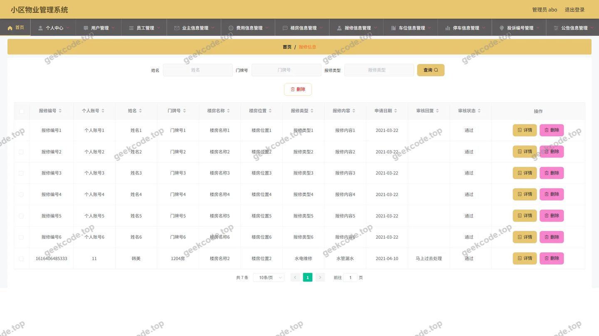</a>

<h4>后台-部门信息</h4>

<a href="https://geekcode.top/archives/Springboot%E7%9A%84%E5%B0%8F%E5%8C%BA%E7%89%A9%E4%B8%9A%E7%AE%A1%E7%90%86%E7%B3%BB%E7%BB%9F?utm_source=github" title="查看完整源码">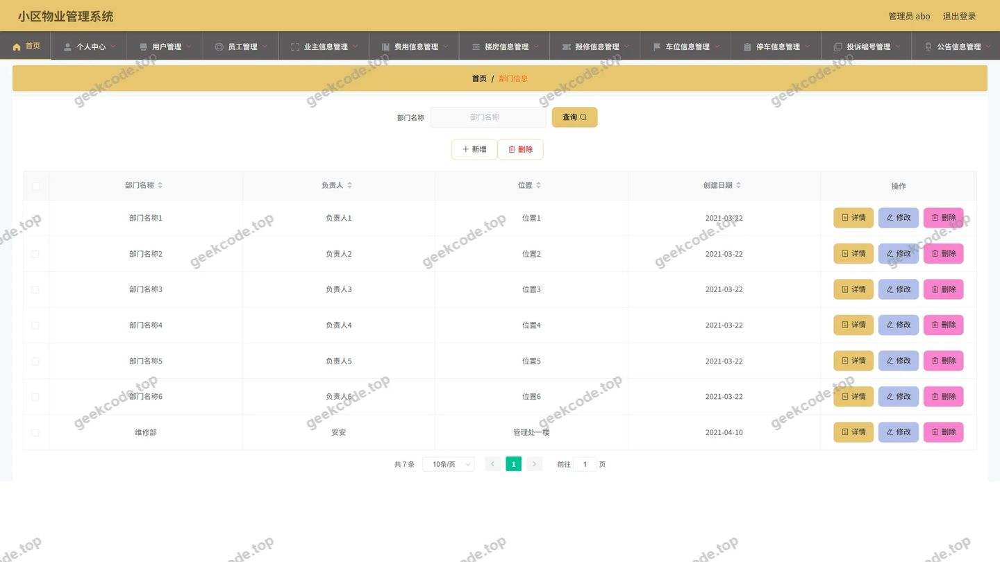</a>

<h4>后台-车位信息</h4>

<a href="https://geekcode.top/archives/Springboot%E7%9A%84%E5%B0%8F%E5%8C%BA%E7%89%A9%E4%B8%9A%E7%AE%A1%E7%90%86%E7%B3%BB%E7%BB%9F?utm_source=github" title="查看完整源码">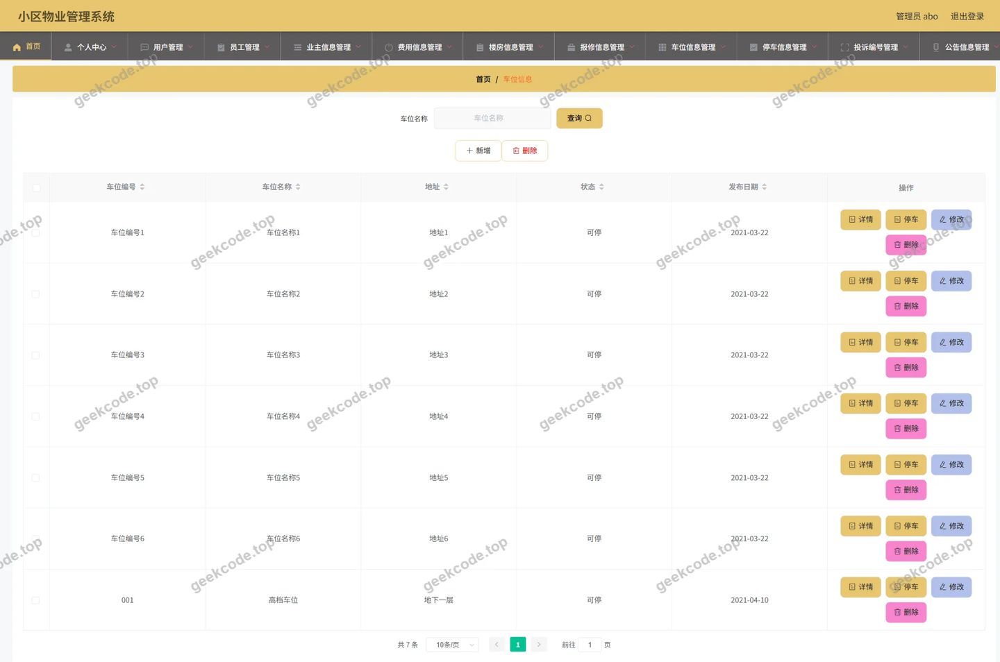</a>

<h4>后台-费用信息</h4>

<a href="https://geekcode.top/archives/Springboot%E7%9A%84%E5%B0%8F%E5%8C%BA%E7%89%A9%E4%B8%9A%E7%AE%A1%E7%90%86%E7%B3%BB%E7%BB%9F?utm_source=github" title="查看完整源码">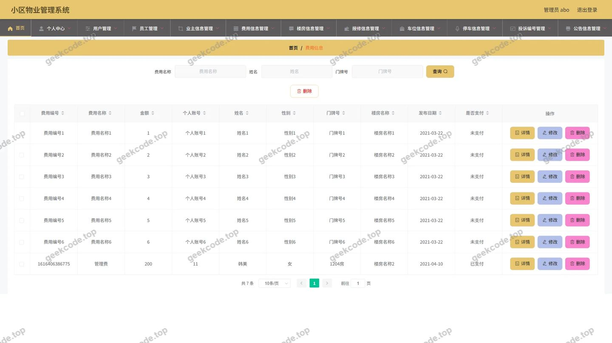</a>

<h4>后台-公告信息</h4>

<a href="https://geekcode.top/archives/Springboot%E7%9A%84%E5%B0%8F%E5%8C%BA%E7%89%A9%E4%B8%9A%E7%AE%A1%E7%90%86%E7%B3%BB%E7%BB%9F?utm_source=github" title="查看完整源码">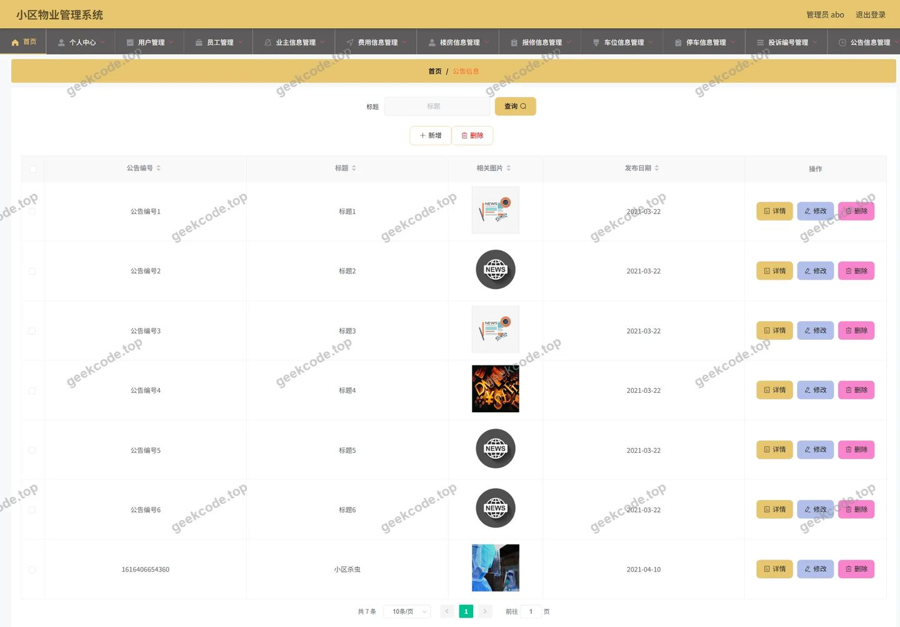</a>

<h4>后台首页</h4>

<a href="https://geekcode.top/archives/Springboot%E7%9A%84%E5%B0%8F%E5%8C%BA%E7%89%A9%E4%B8%9A%E7%AE%A1%E7%90%86%E7%B3%BB%E7%BB%9F?utm_source=github" title="查看完整源码">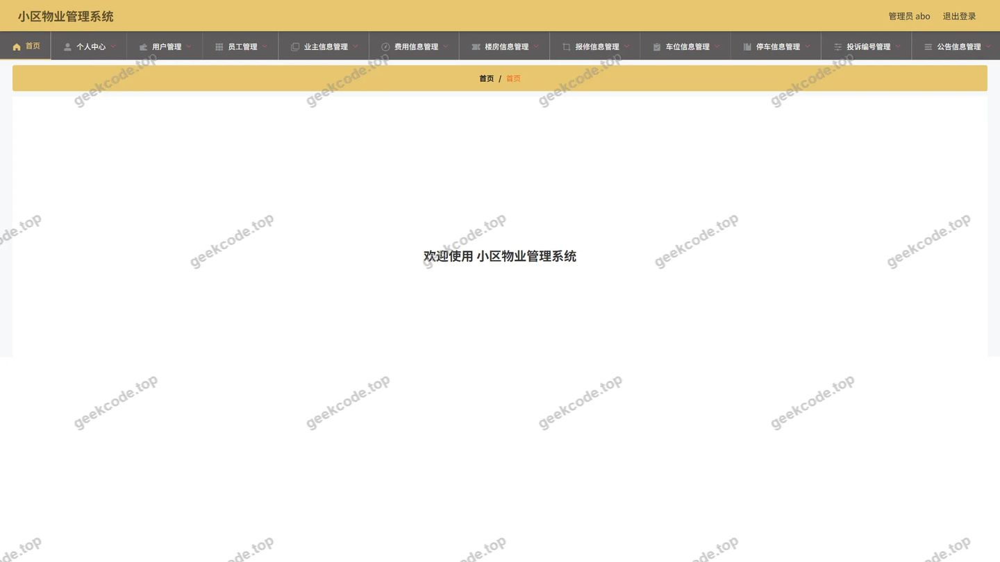</a>

<h4>后台-登录</h4>

<h4>后台-楼房信息</h4>

<a href="https://geekcode.top/archives/Springboot%E7%9A%84%E5%B0%8F%E5%8C%BA%E7%89%A9%E4%B8%9A%E7%AE%A1%E7%90%86%E7%B3%BB%E7%BB%9F?utm_source=github" title="查看完整源码">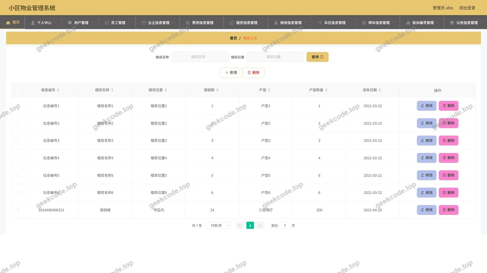</a>

<h4>后台-停车信息</h4>

<a href="https://geekcode.top/archives/Springboot%E7%9A%84%E5%B0%8F%E5%8C%BA%E7%89%A9%E4%B8%9A%E7%AE%A1%E7%90%86%E7%B3%BB%E7%BB%9F?utm_source=github" title="查看完整源码">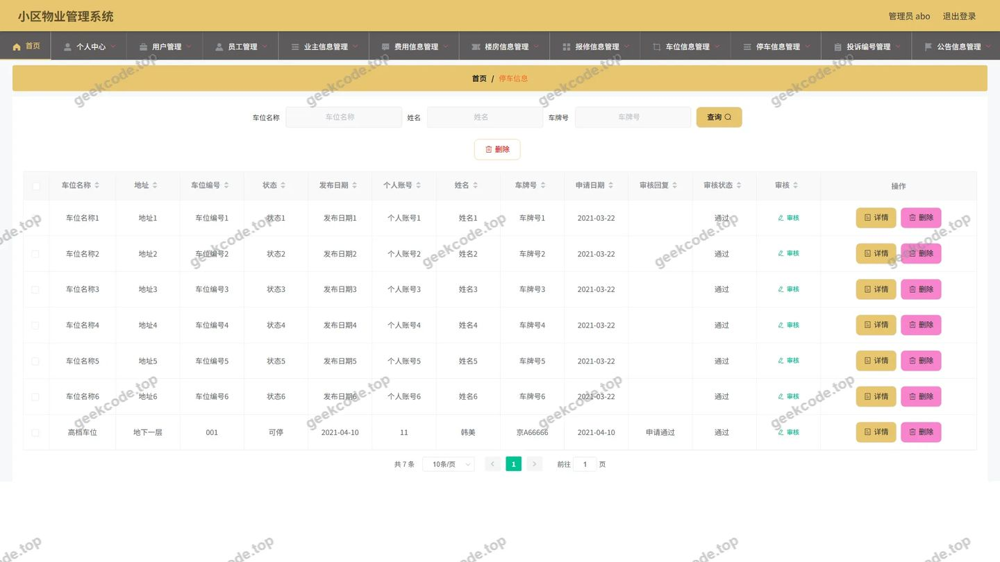</a>

<h4>后台-投诉编号</h4>

<a href="https://geekcode.top/archives/Springboot%E7%9A%84%E5%B0%8F%E5%8C%BA%E7%89%A9%E4%B8%9A%E7%AE%A1%E7%90%86%E7%B3%BB%E7%BB%9F?utm_source=github" title="查看完整源码">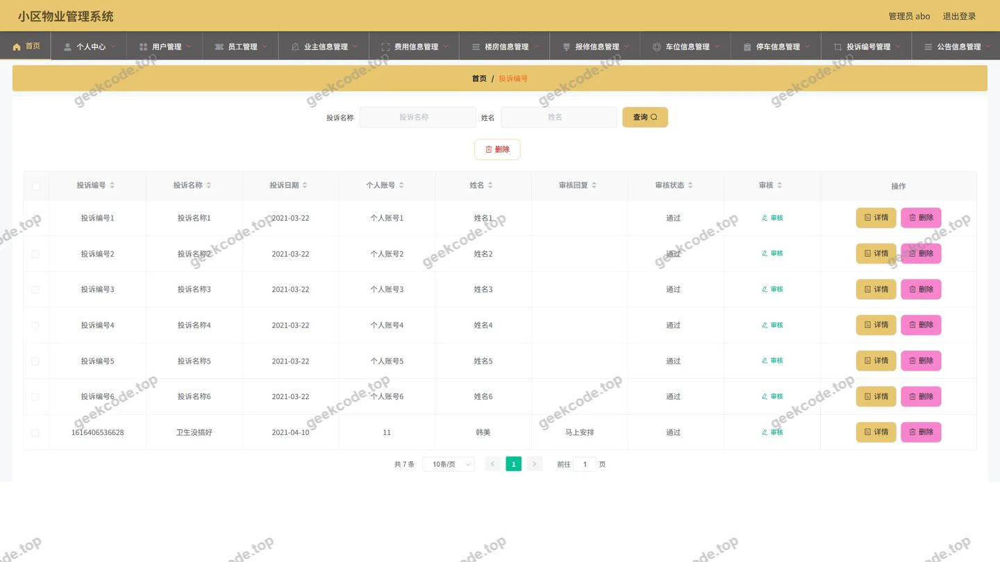</a>

<h4>后台-业主信息</h4>

<a href="https://geekcode.top/archives/Springboot%E7%9A%84%E5%B0%8F%E5%8C%BA%E7%89%A9%E4%B8%9A%E7%AE%A1%E7%90%86%E7%B3%BB%E7%BB%9F?utm_source=github" title="查看完整源码">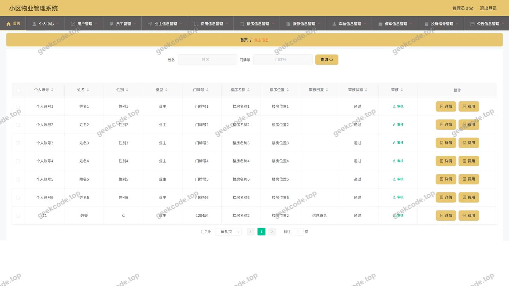</a>

<h4>后台-员工</h4>

<a href="https://geekcode.top/archives/Springboot%E7%9A%84%E5%B0%8F%E5%8C%BA%E7%89%A9%E4%B8%9A%E7%AE%A1%E7%90%86%E7%B3%BB%E7%BB%9F?utm_source=github" title="查看完整源码">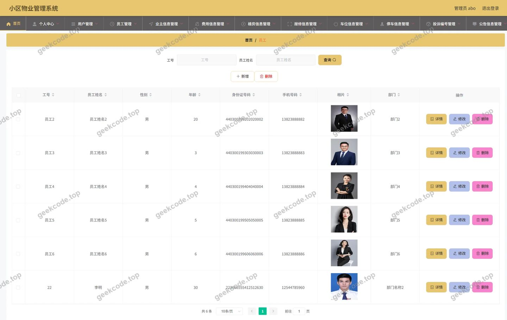</a>

---

## 获取完整源码

| 项目 | 说明 |
| --- | --- |
| 项目名 | Springboot的小区物业管理系统 |
| 运行截图 | 本文 12 张（站点带水印原图，仓库 `images/` 目录） |
| 完整源码 | [https://geekcode.top/archives/Springboot%E7%9A%84%E5%B0%8F%E5%8C%BA%E7%89%A9%E4%B8%9A%E7%AE%A1%E7%90%86%E7%B3%BB%E7%BB%9F?utm_source=github](https://geekcode.top/archives/Springboot%E7%9A%84%E5%B0%8F%E5%8C%BA%E7%89%A9%E4%B8%9A%E7%AE%A1%E7%90%86%E7%B3%BB%E7%BB%9F?utm_source=github) |
| 咨询微信 | **ir9372**（备注：jingpin-yuanma） |
| 更多项目 | [极客代码 geekcode.top](https://geekcode.top/?utm_source=github) |

> 需要源码、部署、改配置、跑不起来等问题，加微信 ir9372 沟通，说明项目名即可。
